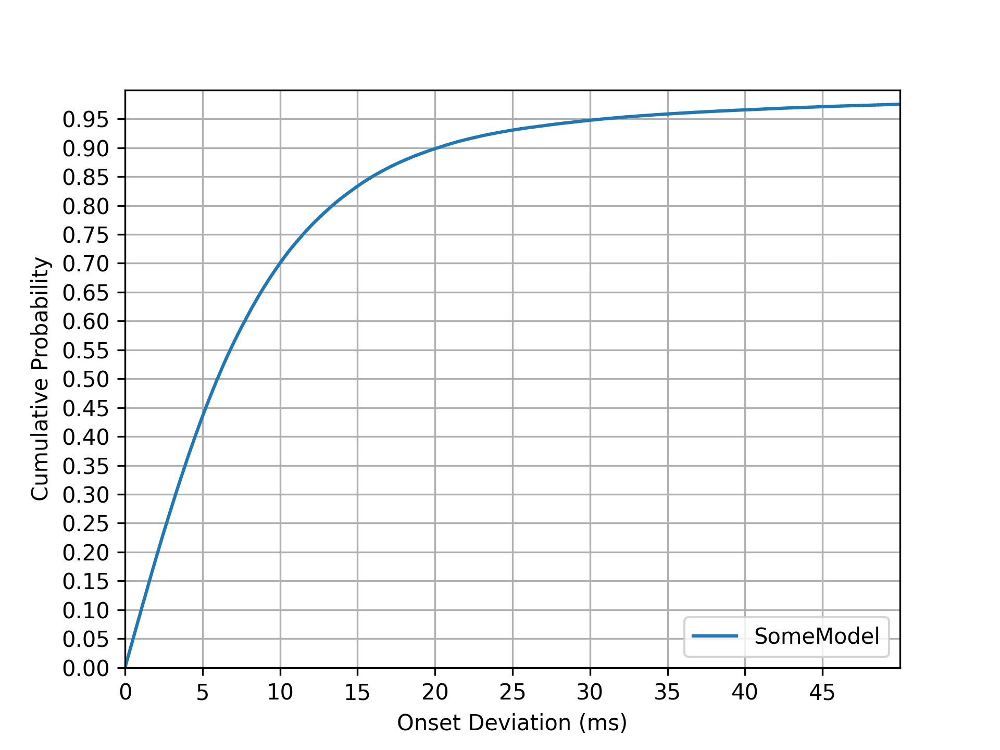

# Piano Transcription with Neural Semi-CRF

## Entrenamiento AMT con datasets en data/

El modelo AMT original se puede entrenar con pares audio/MIDI en archivos
`train.txt`, `val.txt` y `test.txt`, sin convertirlos a metadatos MAESTRO.
Consulta [Transkun_AMT_TRAINING.md](Transkun_AMT_TRAINING.md) para comandos,
checkpoints, logs, reanudación y la medición realizada en la RTX 4050 de 6 GB.
Para trasladar el entrenamiento a otro servidor, seguir
[Transkun_AMT_SERVER.md](Transkun_AMT_SERVER.md), que incluye instalación,
copia del dataset y ejecución desde cero en segundo plano hasta completar
el plan de entrenamiento.

```bash
python -m transkun.trainAMT \
  --datasetRoot ../data/data_saxophone/real_a2s_sax_dataset \
  --partitionDir amt_partitions/saxophone_amt \
  --runDir runs/saxophone_amt_paper --modelConf configs/amt.conf \
  --trainingConf configs/amt_training.conf --device cuda
```

Cada línea de una partición contiene `wav/clip.wav<TAB>midi/clip.mid`, con
rutas relativas al dataset. Para otro corpus se cambian datasetRoot,
partitionDir y runDir. El ejemplo entrena desde cero; `--initAMT` es opcional
para fine-tuning y `--resume` recupera un run previo. Para un entrenamiento
independiente elegir un runDir nuevo. A2S conserva su propio comando y targets
de score.

El preset AMT sigue la tabla del paper V2: batch 12, fragmentos de 16 s,
AdaBelief, LR máximo 4e-4, weight decay 1e-2, OneCycleLR de 500.000 updates
con warm-up del 5% y clipping en el percentil 80 de las últimas 10.000 normas.
El entrenamiento termina por updates, no por 50 épocas. Los argumentos CLI
explícitos prevalecen sobre el preset.

## Adaptación experimental Audio-to-Score

Este repositorio también permite entrenar y ejecutar **Transkun A2S**: mantiene
el frontend y backbone V2, añade una cabeza CTC de símbolos de partitura y
produce Humdrum `**kern` directamente (`.krn` o `.kern`). Admite datasets
monofónicos, polifónicos y de polifonía abierta, también mezclados en un batch.
Los comandos AMT originales siguen disponibles.

Consulta [la documentación técnica](Transkun_A2S_TECHNICAL.md) para dataset,
configuración, entrenamiento, validación e inferencia, y
[el resumen del experimento](Transkun_A2S_OVERVIEW.md) para su objetivo y alcance.

Desde este directorio, con PyTorch/torchaudio compatibles instalados:

```bash
python -m pip install -e '.[a2s,test]'
python -m transkun.trainA2S checkpoint/a2s.pt \
  --modelConf configs/a2s.conf \
  --datasetMetaFile_train /ruta/dataset/train.jsonl \
  --datasetMetaFile_val /ruta/dataset/val.jsonl \
  --initAMT transkun/pretrained/2.0.pt --device cuda
python -m transkun.transcribeA2S /ruta/audio.wav /ruta/score.krn \
  --weight checkpoint/a2s.best.pt --device cuda
python -m pytest -q
```

Cada línea del manifest contiene `{"audio":"audio/clip.wav","score":"scores/clip.krn"}`;
las rutas son relativas al manifest. Se requieren fragmentos emparejados y
targets de partitura; el checkpoint AMT por sí solo todavía no predice A2S.
También se aceptan partituras MusicXML como entrada e inline Kern en el campo
`transcript`. El entrenamiento ajusta automáticamente los pasos CTC según las
longitudes de los targets; `--noAutoFrameMultiplier` exige el valor configurado.
El codec v2 compone números de posición, duración, parte y voz por dígitos.
Los checkpoints A2S v1 existentes pueden seguir exportando Kern; el codec v2
requiere entrenar un nuevo head y no se mezcla silenciosamente con pesos v1.


This repo contains code for following papers for transcribing expressive piano performance into MIDI.

> Yujia Yan and Zhiyao Duan, Scoring intervals using non-hierarchical transformer for automatic piano transcription, in Proc. International Society for Music Information Retrieval Conference (ISMIR), 2024, [Paper](https://arxiv.org/abs/2404.09466)

> Yujia Yan, Frank Cwitkowitz, Zhiyao Duan, Skipping the Frame-Level: Event-Based Piano Transcription With Neural Semi-CRFs, Advances in Neural Information Processing Systems, 2021, 
[OpenReview](https://openreview.net/forum?id=DGA8XbJ8FVd), [paper](https://openreview.net/pdf?id=DGA8XbJ8FVd), [appendix](https://openreview.net/attachment?id=DGA8XbJ8FVd&name=supplementary_material)

## Demo Video:
[](https://www.youtube.com/watch?v=6P3kFHUBicw)


## pip installation

```bash
pip3 install transkun
```

The pip package provides a quick command for transcribing piano performance audio into midi:

```bash
$ transkun input.mp3 output.mid
```

with cuda:

```bash
$ transkun input.mp3 output.mid --device cuda
```

**Note:** The code/pip package shipped checkpoint is trained **without pedal extension of notes**, and **with data augmentation**,which I believe is closer to a real performance. 
Be cautious that the convention for the piano transcription task in previous works is extending all notes by sustain pedal durations. For more checkpoints, e.g, those reported in the paper, see [Model Cards](#model-cards)

**Colab Notebook** [Colab](https://colab.research.google.com/drive/1XuFNdYbcHBy3OyGCmtt2UGa2-PXjkJeo?usp=sharing)

## Overview


This system works as follows: 
1. A score tensor is computed from the input audio that scores every possible intervals for whether or not being an event.
2. The score tensor computed in (1) is then decoded by the proposed semi-CRF layer to obtain event intervals directly via dynamic programming (viterbi).
3. Attributes, e.g., velocity and refined onset/offset position, associated with each interval are then predicted from the extracted event intervals from (2).

### V2 
In V2, as demonstrated in the ISMIR 2024 paper, the changes from V1 are:
1. the model architecture is replaced with a transformer
2. The Score module is simplified with Scaled Inner Product Interval Scaling. The noise score is now zero tensor for compatibility with V1.
3. Segmentwise processing now handles incomplete events with a longer duration 

## Basic Usage

### The Semi-CRF Layer

This code includes an neural semi-CRF module that is optimized for the problem domain.  

Here is a minimal example for using this module:

```python
import CRF
import torch

T = 200
NBatch = 4

# representing the score for the interval [TBegin, TEnd]
# dimensions: [TEnd, TBegin, NBatch]
# only the lower triangular part is used
score = ((torch.randn(T,  T, NBatch))).cuda()

# representing the score for being not an interval, dimensions [TBegin, TBegin+1]
noiseScore= ((torch.randn(T-1,  NBatch))).cuda()

# a list of list of non-overlapping intervals
intervals = [
        [(0,2), (4,6),(6,6), (7,8)],
        [(1,2), (3,5), (19,19)],
        [(0,0),(4,7)],
        [],
        ]

crf = CRF.NeuralSemiCRFInterval(score, noiseScore)

## log probability
logP = crf.logProb(intervals)

## decoding
decoded = crf.decode()

## decoding starting from a given position, useful for segment based processing
decoded = crf.decode(forcedStartPos = [4]*NBatch)
```

### Transcribing piano performance into a MIDI file

```bash
python3 -m transkun.transcribe -h

usage: transcribe.py [-h] [--weight WEIGHT] [--conf CONF] [--device [DEVICE]] [--segmentHopSize SEGMENTHOPSIZE] [--segmentSize SEGMENTSIZE] audioPath outPath

positional arguments:
  audioPath             path to the input audio file
  outPath               path to the output MIDI file

options:
  -h, --help            show this help message and exit
  --weight WEIGHT       path to the pretrained weight
  --conf CONF           path to the model conf
  --device [DEVICE]     The device used to perform the most computations (optional), DEFAULT: cpu
  --segmentHopSize SEGMENTHOPSIZE
                        The segment hopsize for processing the entire audio file (s), DEFAULT: the value defined in model conf
  --segmentSize SEGMENTSIZE
                        The segment size for processing the entire audio file (s), DEFAULT: the value defined in model conf

```

This script can also be used directly as the command line command 'transkun' if the pip package is installed, e.g., 

```bash
$ transkun input.mp3 output.mid
```

## Model Cards

|                  |Dataset                   |Activation|      |      |Note Onset|      |      |Note Onset+Offset|      |      |Note Onset+Offset+ vel.|      |      |pedal activation|      |      |pedal onset|      |      |pedal onset+offset|      |      |
|------------------|--------------------------|----------|------|------|----------|------|------|-----------------|------|------|-----------------------|------|------|----------------|------|------|-----------|------|------|------------------|------|------|
|Checkpoint     |                          |prec      |recall|F1    |prec      |recall|F1    |prec             |recall|F1    |prec                   |recall|F1    |prec            |recall|F1    |prec       |recall|F1    |prec              |recall|F1    |
|[Transkun V2](https://drive.google.com/file/d/1pxGpO8eCdFxMRrXi_YUh7_uC0Ae26coB/view?usp=drive_link)       |Maestro V3                |0.9576    |0.9489|0.953 |0.9956    |0.9714|0.9832|0.9465           |0.9238|0.9349|0.9411                 |0.9186|0.9296|0.9671          |0.9453|0.9541|0.8909     |0.8421|0.8642|0.8632            |0.8165|0.8377|
|                  |MAPS (ad hoc align)       |0.887     |0.8252|0.8535|0.8671    |0.9048|0.8849|0.6325           |0.6613|0.6461|0.4351                 |0.4551|0.4446|0.8498          |0.8547|0.8449|0.6521     |0.7182|0.6732|0.4903            |0.5427|0.5088|
|                  |SMD                       |0.9203    |0.9491|0.934 |0.9816    |0.9766|0.979 |0.9013           |0.8968|0.899 |0.8255                 |0.8211|0.8232|0.9364          |0.9507|0.942 |0.8722     |0.8101|0.8388|0.803             |0.7471|0.773 |
|[Transkun V2 Aug](https://drive.google.com/file/d/1Hg5ua8vYdtg1Y-MnXD0mLyhRK9Srd7hm/view?usp=drive_link)   |Maestro V3                |0.9495    |0.9522|0.9505|0.9971    |0.9715|0.984 |0.9437           |0.9197|0.9314|0.9386                 |0.9149|0.9264|0.9546          |0.9416|0.9454|0.8883     |0.8116|0.8453|0.8497            |0.7790|0.8102|
|                  |MAPS (ad hoc align)       |0.9446    |0.8334|0.8843|0.9396    |0.9056|0.9219|0.7105           |0.6854|0.6975|0.5596                 |0.5401|0.5495|0.8893          |0.8389|0.8583|0.7313     |0.7529|0.7343|0.5499            |0.5650|0.5532|
|                  |SMD                       |0.9389    |0.9518|0.9448|0.997     |0.9801|0.9884|0.9284           |0.9128|0.9205|0.8974                 |0.8823|0.8897|0.9491          |0.9428|0.9447|0.8788     |0.8043|0.8383|0.8208            |0.7526|0.7837|
|[Transkun V2 No Ext](https://drive.google.com/file/d/1LKDJE7Pf4jGbpVeLE8Onxn9KhWVLCRjb/view?usp=drive_link)|Maestro V3 No Ext         |0.8671    |0.825 |0.8441|0.9984    |0.9691|0.9833|0.8271           |0.8034|0.8149|0.823                  |0.7995|0.8109|0.9498          |0.9518|0.9487|0.8872     |0.8105|0.8444|0.8413            |0.7723|0.8031|
|                  |MAPS (ad hoc align) No Ext|0.9093    |0.6383|0.7465|0.941     |0.9044|0.922 |0.5577           |0.5369|0.5469|0.443                  |0.4266|0.4345|0.8753          |0.8471|0.8543|0.7107     |0.7525|0.721 |0.5331            |0.5612|0.5421|
|                  |SMD No Ext                |0.8539    |0.8533|0.8524|0.9982    |0.9774|0.9876|0.7936           |0.7778|0.7855|0.7666                 |0.7513|0.7588|0.9483          |0.9453|0.9455|0.8812     |0.8067|0.8408|0.8215            |0.7539|0.7848|

* onset deviations on MAPS deviates strongly from a Normal distribution, suggesting potential annotation issues.  ad hoc align is used to fix this bias. Offset deviations are still abnormal after this correction.
* Aug means the model is trained with data augmentation
* No Ext means without pedal extension
* The default checkpoint shipped with the code/pip package is Transkun V2 No Pedal Ext. Currently it is fine-tuned from Transkun V2 Aug, will train from scratch in the future.
* There's some minor bug fixes since the paper, the results listed here reflect the latest version which may differ slightly from the paper.

## Handling the dataset

### Converting to the same sampling rate

We assume the data contains only the same sampling rate 44100hz. Therefore for the maestro dataset it is necessary to perform sampling rate conversion to 44100hz for the last two years (2017 and 2018) .  

### Generating metadata files

Assuming all audio files have already been converted to the same sampling rate, we iterate the entire dataset to combine the groundtruth midi and metadata into a single file.

The following script will generate train.pt, val.pt and test.pt

```bash
python3 -m transkun.createDatasetMaestro -h
usage: createDatasetMaestro.py [-h] [--noPedalExtension] datasetPath metadataCSVPath outputPath

positional arguments:
  datasetPath         folder path to the maestro dataset
  metadataCSVPath     path to the metadata file of the maestro dataset (csv)
  outputPath          path to the output folder

optional arguments:
  -h, --help          show this help message and exit
  --noPedalExtension  Do not perform pedal extension according to the sustain pedal
```

This command will generate train.pt, dev.pt, test.pt in the outputPath.

## Training

After generating the metadata files, we can perform training using the dataset. During training, the audio waveforms will be fetched directly from the original .wav files.

Firstly, generate a config template file for the model.:

```bash
mkdir checkpoint
python3 -m moduleconf.generate Model:transkun.ModelTransformer > checkpoint/conf.json
```

Then we call the training script.

```bash
python3 -m transkun.train -h
```

## The Evaluation Module

### Comparing the output MIDI files and the groundtruth MIDI files

We also provide an out-of-box tool for computing metrics directly from output midi files.

```bash
usage: computeMetrics.py [-h] [--outputJSON OUTPUTJSON] [--noPedalExtension] [--applyPedalExtensionOnEstimated] [--nProcess [NPROCESS]] [--alignOnset] [--dither DITHER]
                         [--pedalOffset PEDALOFFSET] [--onsetTolerance ONSETTOLERANCE]
                         estDIR groundTruthDIR

compute metrics directly from MIDI files.
Note that estDIR should have the same folder structure as the groundTruthDIR.
The MIDI files to evaluate should have the same extension as the ground truth.
Metrics outputed are ordered by precision, recall, f1, overlap.

positional arguments:
  estDIR
  groundTruthDIR

options:
  -h, --help            show this help message and exit
  --outputJSON OUTPUTJSON
                        path to save the output file for detailed metrics per audio file
  --noPedalExtension    Do not perform pedal extension according to the sustain pedal for the ground truth
  --applyPedalExtensionOnEstimated
                        perform pedal extension for the estimated midi
  --nProcess [NPROCESS]
                        number of workers for multiprocessing
  --alignOnset          whether or not to realign the onset.
  --dither DITHER       amount of noise added to the prediction.
  --pedalOffset PEDALOFFSET
                        offset added to the groundTruth sustain pedal when extending notes
  --onsetTolerance ONSETTOLERANCE
                        onset tolerance, default: 0.05 (50ms)

```

Currently, we do not support evaluation of multitrack MIDIs.

This command can also be used directly as the command line script 'transkunEval' if the pip package is installed.

### Ploting the empirical cumulative distribution function to visualize the onset/offset accuracy

Use the following script to plot the ECDF curve for onset/offset deviations:

```bash
usage: plotDeviation.py [-h] [--labels [LABELS ...]] [--offset] [--T T] [--output [OUTPUT]] [--noDisplay] [--cumulative] [--absolute] [--targetPitch TARGETPITCH]
                        evalJsons [evalJsons ...]

plot the empirical cumulative distribution function on onset/offset deviations

positional arguments:
  evalJsons             a seqeunce of the output json files from the computeMetrics script, the deviation output should be enabled

options:
  -h, --help            show this help message and exit
  --labels [LABELS ...]
                        specify labels to show on the legend
  --offset              plot the offset deviation curve. If not specified, onset deviation curve will be plotted
  --T T                 time limit(ms), default: 50ms
  --output [OUTPUT]     filename to save
  --noDisplay           Do not show the figure.
  --cumulative          plot the empirical cumulative density. 
  --absolute            use absolute deviation.
  --targetPitch TARGETPITCH
                        only plot specific number.

```



### Citation

If you find this repository helpful, please consider citing:


Bibtex:

```bibtex
@inproceedings{
yan2021skipping,
title={Skipping the Frame-Level: Event-Based Piano Transcription With Neural Semi-{CRF}s},
author={Yujia Yan and Frank Cwitkowitz and Zhiyao Duan},
booktitle={Advances in Neural Information Processing Systems},
editor={A. Beygelzimer and Y. Dauphin and P. Liang and J. Wortman Vaughan},
year={2021},
url={https://openreview.net/forum?id=AzB2Pq7UFsA}
}
```


```bibtex
@inproceedings{yan2024scoring,
  author    = {Yujia Yan and Zhiyao Duan},
  title     = {Scoring Time Intervals Using Non-Hierarchical Transformer for Automatic Piano Transcription},
  booktitle = {Proc. International Society for Music Information Retrieval Conference (ISMIR)},
  year      = {2024},
}
```
